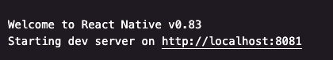

# Upgrade to React Native 0.83

In this step you will use the AI Assisted Upgrade Helper in the Amazon Devices Builder Tools MCP server to migrate a Vega app from React Native 0.72 to React Native 0.83. By the end you will have a working Vega app running on Vega SDK 0.24 with React Native 0.83.

## Before you start

Make sure you've completed the workshop [Prerequisites](./0-prerequisites.md).

We'd love your feedback on what works (and what doesn't) as you go through this workshop. To make that easy, kick the session off by giving your AI agent the bootstrap prompt below.

🤖 **Prompt your agent (paste this once, at the start of the workshop):**

```
We are going to upgrade an existing Vega React Native app from 0.72 to 0.83 using the workshop steps I'll provide. This is a prompt-driven workshop — I'll be giving you instructions and prompts for each step.

First, let's record the active AI agent name (Claude, Cursor, etc) and the Model used (Claude Opus/Sonnet XX, Codex YY, etc).

As we go, log the following in a markdown file called PROMPT_UPGRADE_PROCESS.md in the project root. For each prompt, record:

| Column | Description |
|--------|-------------|
| Step | Which workshop step this belongs to (e.g., "RN 0.83 Upgrade", "React Compiler", etc.) |
| Prompt | The exact text prompt I used |
| Start Time | When I issued the prompt |
| End Time | When the task completed |
| Duration | Elapsed time |
| Outcome | ✅ Success, ⚠️ Partial/friction, or ❌ Failed |
| Notes | Any friction, errors, workarounds, or observations |

If a single prompt involves multiple sub-steps, log the top-level prompt as one row, and optionally add indented sub-rows for notable sub-steps (especially if they hit friction or failed independently).

Keep the file updated after every prompt — don't batch them at the end.

When I say "Wrap up my feedback", produce a summary section at the bottom of PROMPT_UPGRADE_PROCESS.md that includes:
1. **Overall stats** — total prompts, total time, success/partial/fail counts
2. **Friction hotspots** — the steps or prompts that caused the most trouble, ranked by severity
3. **What worked well** — prompts/steps that were smooth and fast
4. **Recommendations** — specific, actionable suggestions for the Vega RN 0.83 team and prompt/script authors to improve the upgrade experience
5. **Raw upgrade timeline** — a simplified chronological view of the session

The audience for this feedback is Amazon development engineers working on Vega RN 0.83 and the workshop prompt/script itself. Be specific and constructive — call out exact error messages, unclear instructions, missing context, or steps that needed manual intervention.
```

ℹ️ Once the agent confirms it's tracking, move on to Step 1. When you finish the last lesson, send `Wrap up my feedback` to generate the summary.

## What's new in React Native 0.83

A few highlights worth knowing about before you run the upgrade:

- **React 19 and the React Compiler** bring automatic performance optimisations, including eliminating the need for `useMemo` in many cases.
- **Hermes v1 ("Static Hermes")** is a next-generation JavaScript engine that delivers improved runtime performance.
- **Updated libraries** including React Navigation, Gesture Handler, and Lottie are uplevelled to support the new version.
- **Improved developer tooling**, including the new React Native DevTools and the AI-powered migration assistant used in this step.

React Native for Vega 0.83 aligns more closely with the framework versions released by Meta, which means you can share more code across Vega, Fire OS, and web. For the full list of changes, see the [Vega SDK 0.24 release notes](https://developer.amazon.com/docs/vega/0.24/vega-release-notes#react-native-0-83-for-vega-is-now-available).

We'll explore these benefits hands-on in exercises in the coming sections.

## Step 1: Pick the app you will upgrade

Pick one of the two options below.

**Option A: Your own Vega app on a new branch**

Use this option if you want to see how the upgrade lands against your real codebase. Create a fresh branch so you don't mix upgrade changes with production work:

```bash
cd /path/to/your/vega-app
git checkout -b upgrade/react-native-0.83
```

**Option B: Our sample app**

Use this option if you don't have a Vega app handy or want a clean run-through first. Fork [react-native-multi-tv-helloworld](https://github.com/AmazonAppDev/react-native-multi-tv-helloworld) on GitHub (top-right **Fork** button) so you have somewhere to commit your changes, then clone your fork:

```bash
git clone https://github.com/<your-username>/react-native-multi-tv-helloworld.git
cd react-native-multi-tv-helloworld
git checkout -b upgrade/react-native-0.83
```

ℹ️ If this is your first time using the upgrade helper, run through Option B first. It's a faster loop and a safe place to learn the interactive commands before you point the helper at your own code.

## Step 2: Trigger the upgrade helper

🤖 **Prompt your agent.** In your AI coding assistant, run one of the following.

**For Kiro, Claude Code, or Cline**, use the slash command:

```
/prompt react_native_for_vega_ai_assisted_rn_upgrade
```

**For other agents**, send this prompt instead:

```
Use the React Native Upgrade workflow from @amazon-devices/amazon-devices-buildertools-mcp to upgrade my application to RN83.
```

The upgrade helper will then:

1. Ask for your working directory (or detect it if you're already in the project).
2. Detect your current React Native version from `package.json`.
3. Validate your project structure and environment.
4. Load Vega-specific knowledge for React Native 0.83.
5. Generate a TODO list of all required changes.
6. Enter interactive mode where you work through changes step-by-step.

## Step 3: Review the generated TODO list

The upgrade helper generates a TODO file in your project directory named:

```
RN_UPGRADE_TODO_[current_version]_to_0.83.md
```

For example: `RN_UPGRADE_TODO_0.72_to_0.83.md`.

The TODO file includes:

- Progress tracking with checkboxes (⭕ pending, ✅ completed).
- Priority indicators (🔴 Critical, 🟡 High, 🟢 Medium, 🔵 Low).
- Detailed implementation steps for each change.
- Code examples and file references.

✅ **Checkpoint:** Confirm the TODO file was created in your project directory. That tells you the upgrade helper initialised correctly.

ℹ️ One of the TODO items will guide you to run `npm / yarn install` to update dependencies. The upgrade helper will help troubleshoot any installation errors.

## Step 4: Work through changes interactively

The helper enters an interactive mode showing all pending changes organised by priority.

**Interactive commands:**

- `[1-N]`: select a change by number to view its implementation guide. For simple changes, the AI may offer to implement it for you automatically.
- `complete`: mark the current change as done after manual implementation.
- `build`: report a build error for knowledge-grounded troubleshooting.
- `status`: view a detailed progress report.
- `help`: show the command reference.
- `exit`: save progress and exit. This creates `.rn-upgrade-checkpoint.json` so you can resume later.

**Workflow:**

1. The helper displays pending changes grouped by priority (for example, 🔴 Critical or 🟡 High).
2. Type a number to select a change.
3. Review the implementation guide with detailed steps.
4. Either accept the AI's offer to implement it, or implement manually and type `complete`.
5. Repeat for the remaining changes.

Progress is saved automatically. You can pause at any time and resume later by re-running the trigger command from Step 3.

## Step 5: Build and run on a device

Once you've worked through the TODO list, build and launch the app. The rest of the workshop refers back to this step every time it says "build and run on Vega" — pick whichever of the three options below fits your workflow.

ℹ️ **Your build commands may vary.** The terminal commands below assume the `react-native-multi-tv-helloworld` monorepo (yarn workspaces), since the rest of the workshop builds against it. If you're upgrading your own app from Option A, swap in whatever your project uses (`npm run`, plain `react-native run-...`, an internal CLI, etc.). The Vega Studio and AI agent options below work either way.

**Option 1: Terminal (canonical commands)**

```bash
yarn vega:build                        # debug build
yarn workspace @multitv/vega start     # Metro (separate terminal)
yarn vega:vvd:mseries                  # launch on the Vega VD (M-series Mac)
# yarn vega:vvd:intel                  # Intel Mac
# yarn vega:firetv                     # Fire TV Stick (release build only)
```

**Option 2: Vega Studio in VS Code**

The Vega Studio sidebar has Run / Build buttons that wrap the same `yarn` scripts. Easiest if you're already in the IDE.

**Option 3: 🤖 Prompt your AI agent**

```
Build and run this Vega app on the connected device.
```

The agent picks the right `yarn vega:*` script for your platform and runs it. Handy when you're switching branches or rebuilding after a config change.

Confirm React Native 0.83 is actually running. When the app boots, the Metro terminal (or the Output panel in Vega Studio if you're running from the IDE) prints the React Native version. Check it shows **0.83** — not 0.72.



✅ **Checkpoint:** Your 0.83 app builds against Vega SDK 0.24 and launches on the Vega Virtual Device or Fire TV Stick.

## Troubleshooting

If you hit build errors, the agent can troubleshoot via the upgrade helper:

🤖 **Prompt your agent:**

```
Based on the @amazon-devices/amazon-devices-buildertools-mcp knowledge base, what are the package.json dependency changes that need to happen for an RN83 upgrade?
```

---

**Previous:** [Prerequisites](./0-prerequisites.md) · **Next:** [See the React Compiler in action](./2-react-compiler.md)
