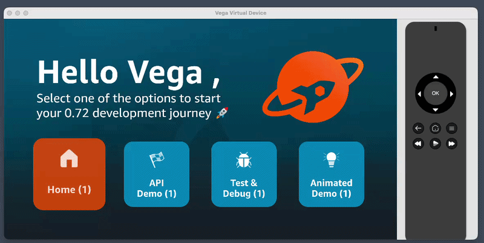
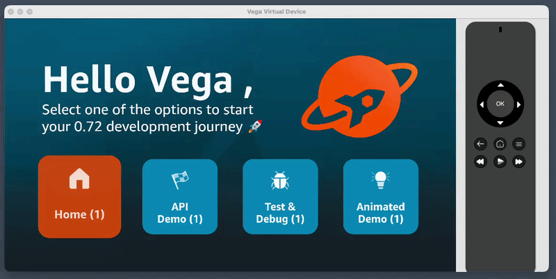

# See the React Compiler in action

In this step you will compare the same app on React Native 0.72 (React 18) and React Native 0.83 (React 19 + the React Compiler).

## Before you start

Make sure you've completed the workshop [Prerequisites](./0-prerequisites.md).

We'll work against the [Multi-TV Hello World](https://github.com/AmazonAppDev/react-native-multi-tv-helloworld) sample, which has two branches set up for the comparison:

- `main` — RN 0.72 / React 18
- `release-rn-83` — RN 0.83 / React 19

If you already forked and cloned this sample in [Step 1](./1-rn-0.83-upgrade.md), `cd` into your existing clone. Otherwise, fork [react-native-multi-tv-helloworld](https://github.com/AmazonAppDev/react-native-multi-tv-helloworld) on GitHub (top-right **Fork** button), then clone your fork:

```bash
git clone https://github.com/<your-username>/react-native-multi-tv-helloworld.git
cd react-native-multi-tv-helloworld
git checkout release-rn-83
git checkout main
yarn install
```

## What the React Compiler does

In React 19, the compiler is a Babel plugin that automatically memoises components, props, and callbacks at build time. Most uses of `useMemo`, `useCallback`, and `React.memo` become unnecessary.

This matters more on TV than on phone or web. Focus is constant state churn — every directional-pad press re-renders the parent and every focusable child. Fire TV Stick has less CPU headroom, so a wasted render that's invisible on an iPhone can drop a frame here. Focus-heavy screens are also where manual memoisation is most fragile (most wrappers, longest dep arrays, most opportunities to get it wrong) — exactly the work the compiler takes off your plate.

🤖 **Prompt your agent.** If you'd prefer, copy the steps below to your agent and follow along.

## Step 1: Add a render-count badge on `main` (0.72)

We'll use a small on-screen counter to make re-renders visible.

Copy [`RenderBadge.tsx`](./references/compiler/RenderBadge.tsx) into `packages/shared/src/components/RenderBadge.tsx` on `main`.

Now use it inside `Tile`. In `packages/shared/src/components/Tile.tsx`, add the import:

```tsx
import { RenderBadge } from "./RenderBadge";
```

And render the badge inside the existing label `<Text>`:

```tsx
<Text style={styles.label}>
  {label} <RenderBadge isFocused={isFocused} />
</Text>
```

✅ **Checkpoint:** Build and run the app — see [Step 1: Build and run on a device](./1-rn-0.83-upgrade.md#step-5-build-and-run-on-a-device) for the three ways to do this (terminal / IDE / agent). Each tile shows a number, press right across the row.

The sample's `Tile` is wrapped in `React.memo` and `HomeScreen` wraps its focus handlers in `useCallback`, so manual memoisation is in place. In the clip below, focus moves back and forth between the two **inner** tiles a few times. With memoisation working, only the tile losing focus and the tile gaining focus re-render — so the inner pair's counters climb to ~7 by the end, while the outer two stay at 2 (they render once on mount and never again).



## Step 2: Break the manual memoisation on `main` (0.72)

To see what the compiler will do for us, we first need to see what manual memoisation was doing. Stay on `main`. We'll strip the manual `memo`/`useCallback` machinery and watch the render counts.

In `packages/shared/src/components/Tile.tsx`, unwrap the `memo` and remove the per-tile `useCallback`:

```tsx
// Before
import React, {memo, useCallback} from 'react';
// ...
export const Tile = memo(
  ({id, label, icon, isFocused, onFocus, onBlur, ...}: TileProps) => {
    const handleFocus = useCallback(() => onFocus(id), [id, onFocus]);
    // ...
    return <TouchableOpacity onFocus={handleFocus} ... />;
  },
);

// After
import React from 'react';
// ...
export const Tile = ({id, label, icon, isFocused, onFocus, onBlur, ...}: TileProps) => {
  return <TouchableOpacity onFocus={() => onFocus(id)} ... />;
};
```

In `packages/shared/src/screens/HomeScreen.tsx`, drop the `useCallback` wrappers:

```tsx
// Before
import React, { useState, useCallback } from "react";
// ...
const handleTileFocus = useCallback((tileId: string) => {
  setFocusedTileId(tileId);
}, []);
const handleTileBlur = useCallback(() => {
  setFocusedTileId("home");
}, []);

// After
import React, { useState } from "react";
// ...
const handleTileFocus = (tileId: string) => {
  setFocusedTileId(tileId);
};
const handleTileBlur = () => {
  setFocusedTileId("home");
};
```

Reload the app. Press right across the tile row.

✅ **Checkpoint:** **Every tile's number ticks on every focus change** — even though only two tiles are actually changing focus state. This is because `HomeScreen` now creates fresh `onFocus` / `onBlur` references on every render, and `Tile` no longer skips re-rendering when its props haven't meaningfully changed.

Functionally the app still works but the cost is rendering compute. A typical Fire TV catalog row is 30+ tiles across several rows, with focus moving on every d-pad press — that's hundreds of wasted re-renders per second of navigation. The result is dropped frames and a sluggish d-pad. The React Compiler removes all of the manual configuration for you — no `memo`, no `useCallback`, no dep arrays to maintain.



Commit the badge & the broken-memoisation state together.

```bash
git add .
git commit -m "Add render-count badge and strip manual memoisation"
```

## Step 3: Port the broken-memoisation state to `release-rn-83`

The badge and the un-memoised source need to land on the 0.83 branch too — same code, different React version. Capture the commit SHA from Step 2, then cherry-pick it onto `release-rn-83`:

```bash
git rev-parse HEAD   # copy the SHA
git checkout release-rn-83
git cherry-pick <paste-the-SHA-here>
```

🤖 **Prompt your agent.** If you'd rather have your AI assistant do it:

```
Apply the latest commit from main (the render-count badge and manual-memoisation removal) to release-rn-83 using git cherry-pick. Resolve any conflicts in packages/shared/src/components/Tile.tsx and packages/shared/src/screens/HomeScreen.tsx.
```

Build, run, and traverse the tile row — see [Step 1: Build and run on a device](./1-rn-0.83-upgrade.md#step-5-build-and-run-on-a-device) for terminal / IDE / agent options.

✅ **Checkpoint:** All four tiles still tick on every focus change. Being on React 19 alone changes nothing; the compiler is a separate Babel plugin we haven't enabled yet — that's what Step 4 fixes.

## Step 4: Enable the React Compiler on Vega

The compiler ships as a separate Babel plugin: `babel-plugin-react-compiler`. The upgrade helper handles the React/RN version bumps but does **not** wire the compiler into your build, so we need to do it ourselves.

`Tile` and `HomeScreen` live in the `shared` package, so the compiler has to be wired into both `vega` and `shared` for the Vega build to see it.

### 4a. Install the plugin in both packages

```bash
yarn workspace @multitv/vega add -D babel-plugin-react-compiler
yarn workspace @multitv/shared add -D babel-plugin-react-compiler
```

### 4b. Update `packages/vega/babel.config.js`

Keep your existing `presets` array. Add a `plugins` array alongside it:

```js
module.exports = {
  presets: [
    // ...your existing presets, unchanged
  ],
  plugins: [["babel-plugin-react-compiler", { target: "19" }]],
};
```

### 4c. Update `packages/shared/babel.config.js`

Same change here — leave the presets, add the plugin:

```js
module.exports = {
  presets: [
    // ...your existing presets, unchanged
  ],
  plugins: [["babel-plugin-react-compiler", { target: "19" }]],
};
```

### 4d. Add a custom Babel transformer

The babel.config.js changes above aren't enough on their own — Metro on Vega doesn't pick them up. The reason is monorepo-specific:

- The Vega Metro config sets `projectRoot: monorepoRoot` so Metro can resolve assets and source files across packages (this is what makes the `shared/` package work).
- Metro's default Babel transformer reads `babel.config.js` from `projectRoot` only — it doesn't walk up. With `projectRoot` pointing at the monorepo root, Metro never sees `packages/vega/babel.config.js`, so the compiler plugin never runs.
- The transformer supports an `extendsBabelConfigPath` option that _does_ solve this, but Metro doesn't expose a way to set it from `metro.config.js`. The cleanest fix is a thin wrapper around the default transformer.

Copy [`babel-transformer.js`](./references/compiler/babel-transformer.js) into `packages/vega/babel-transformer.js`.

Now every file Metro transforms — including files from `packages/shared` that get pulled into the graph — runs through `packages/vega/babel.config.js` and gets the compiler treatment.

### 4e. Wire the transformer into `packages/vega/metro.config.js`

Add a `transformer` block to your existing config:

```js
const config = {
  // ...existing projectRoot, watchFolders, resolver…
  transformer: {
    babelTransformerPath: require.resolve("./babel-transformer.js"),
  },
};
```

### 4f. Rebuild and run

```bash
rm -rf packages/vega/build
```

Then build and launch — see [Step 1: Build and run on a device](./1-rn-0.83-upgrade.md#step-5-build-and-run-on-a-device).

✅ **Checkpoint: memoisation is back — without the manual code.** Press right across the tile row. Only the two affected tiles' badges should tick now (the one losing focus and the one gaining it). Untouched tiles stay flat — exactly the behaviour we had on `main` _before_ we stripped `memo` and `useCallback` in Step 2. The compiler is doing that work for you automatically.


_Same selective-render behaviour as Step 1, this time with no `memo`, no `useCallback`. The compiler restored it for you._

ℹ️ **A note on cost.** Even _correctly memoised_ re-renders aren't free: every render runs the `useCallback` factory, every `React.memo` runs a shallow prop check. On 4 tiles the difference is small, but on a 30-item catalog row on a Fire TV Stick it adds up.

The compiler removes both the boilerplate _and_ the per-render bookkeeping cost.

In the next step we'll use React Native DevTools to _see_ the compiler at work.

---

**Previous:** [Run the React Native 0.83 upgrade helper](./1-rn-0.83-upgrade.md) · **Next:** [Use React Native DevTools](./3-react-native-devtools.md)
