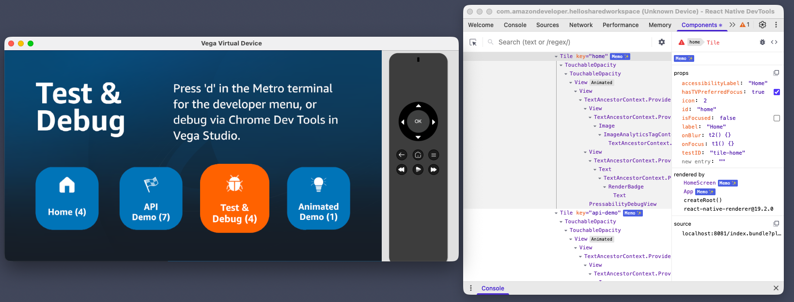
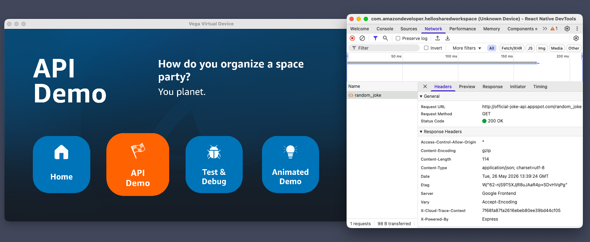
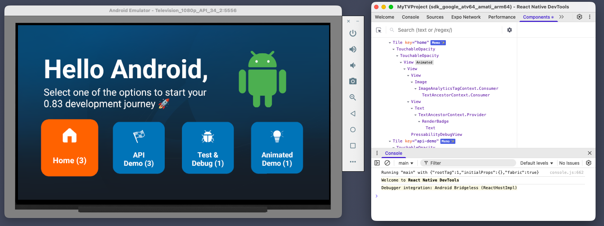

# Use React Native DevTools

In this step you will set up React Native DevTools — the in-browser debugger that ships with React Native 0.83 — and use it to verify the React Compiler ran on the app you built in [Step 2](./2-react-compiler.md). You'll see the **Memo ✨** badge that DevTools renders on compiled components, and (optionally) profile renders.

## Before you start

Make sure you've completed [Step 2](./2-react-compiler.md) — you'll need a debug build of either the Vega app (`@multitv/vega`) on a device or virtual device, plus Metro running.

## What React Native DevTools does

[React Native DevTools](https://reactnative.dev/docs/react-native-devtools) is the same DevTools you may have used in the browser elsewhere, just opened from Metro via the `j` keystroke. On Vega specifically, it replaces the older standalone `react-devtools` flow — see the [Vega 0.24 docs](https://developer.amazon.com/docs/vega/0.24/react-devtools) for the platform-specific setup.

## Step 1: Open RN DevTools on Vega

Vega's RN DevTools workflow needs **two terminals** plus the running app.

For more information see the [Vega 0.24 docs](https://developer.amazon.com/docs/vega/0.24/react-devtools).

### 1a. Forward the Metro port

```bash
vega device start-port-forwarding -p 8081 -f false -d VirtualDevice
```

Swap `VirtualDevice` for the device serial from `vega device list-devices` if you're on a physical Fire TV Stick. Drop the `-d` flag entirely if only one device is connected.

### 1b. Start Metro

In a second terminal:

```bash
yarn workspace @multitv/vega start
```

Wait for Metro to display:

```
INFO  Dev server ready.
INFO  Key commands available:
 r - reload app(s)
 d - open Dev Menu
 j - open DevTools
```

### 1c. Launch the app

Back in the first terminal (or a third — Metro keeps running). The root-level scripts launch the right architecture-specific vpkg on the right device:

```bash
yarn vega:vvd:mseries   # M-series Mac on the Vega Virtual Device
# yarn vega:vvd:intel   # Intel Mac on the Vega Virtual Device
# yarn vega:firetv      # Fire TV Stick (release build only)
```

These assume you've already run `yarn vega:build` (debug) or `yarn workspace @multitv/vega run build:release` (release for Fire TV).

When the app connects, you'll see `BUNDLE index.js` in the Metro terminal — that confirms the bridge is up. If you don't see it, port forwarding probably isn't active.

### 1d. Open DevTools

In the Metro terminal, press **`j`**. A browser window opens with React Native DevTools.

✅ **Checkpoint:** DevTools opens in your browser and shows the running app's component tree on the left.



## Step 2: Verify the React Compiler ran

This is where you confirm the compiler is actually doing the work the on-screen render badges suggest it is.

With your Vega app running, switch to the **Components** tab at the top of DevTools. The component tree appears on the left — start at the root (`App`, or `RootComponent` on Vega) and expand down until you find `HomeScreen` and `Tile`. Click each one and look at the name in the tree.

**The Memo ✨ badge.** When the React Compiler optimises a component, DevTools renders a small **`Memo ✨`** label next to its name. This is the authoritative signal that the compiler ran on that component. `RenderBadge` won't have a sparkle — that's expected, because mutating a ref during render makes it ineligible. That's also why we extracted `RenderBadge` into its own file: keeping the rule violation contained means `Tile` itself stays optimisable.

ℹ️ **Bonus: highlight updates.** In the settings cog (top-right of the Components panel), tick **"Highlight updates when components render"**. Components flash a coloured outline whenever they re-render — green for cheap, red for expensive. Useful for _seeing_ re-render behaviour live without instrumenting the source.

## Step 3: Inspect a network request

The Network panel that comes with RN Devtools is a great benefit of the 0.83 upgade. On 0.72 you'd reach for Charles Proxy or Flipper to see `fetch` traffic; now it's built in. The sample app already includes an API Demo tile that fires an API request, so we can use that.

### 3a. Open the Network panel and trigger a request

In RN DevTools, click the **Network** tab. Then on the device, navigate to the **API Demo** tile and select it.

### 3b. Inspect the request

The request should appear in the Network panel's request list. Click it to expand. The right-hand pane gives you:

- **Headers** — request and response headers, including status, MIME type, and content length.
- **Payload** — the JSON body returned by the server, rendered as an inspectable tree.
- **Timing** — how long DNS lookup, connection, request, and response each took.

✅ **Checkpoint:** You can see the response body directly in DevTools — no Charles Proxy, no Flipper, no source patching.



## Step 4: See it working on Expo (optional)

The `shared` package runs unchanged across Vega, Fire OS, Android TV, Apple TV, and web — and with the React Compiler enabled, the same `Tile` and `HomeScreen` get the **Memo ✨** treatment everywhere. Running the Expo target on Android TV is the most direct way to see that: one codebase, two of Amazon's TV platforms (Vega + Fire OS), zero platform-specific compiler config.

### Prerequisites

You'll need an Android development environment configured (Android Studio + an Android TV emulator or a connected Fire OS device).

If you don't have Android set up, see [Expo's Android Studio setup guide](https://docs.expo.dev/get-started/set-up-your-environment/?platform=android).

### 3a. Install and configure

The compiler plugin needs to be installed in the workspace whose `babel.config.js` references it. We installed it in `@multitv/vega` and `@multitv/shared` in [Step 2 (4a)](./2-react-compiler.md#4a-install-the-plugin-in-both-packages); now do the same for the Expo workspace:

```bash
yarn workspace @multitv/expotv add -D babel-plugin-react-compiler
```

Create `packages/expotv/babel.config.js`:

```js
module.exports = function (api) {
  api.cache(true);
  return {
    presets: [["babel-preset-expo", { jsxImportSource: "react" }]],
    plugins: [["babel-plugin-react-compiler", { target: "19" }]],
  };
};
```

### 3b. Run with a fresh cache

Run the app:

```bash
yarn workspace @multitv/expotv start --reset-cache
# In another terminal:
yarn run expotv:android --device   # or expotv:ios
```

ℹ️ The `--reset-cache` matters whenever you've changed `babel.config.js` (e.g. enabling the React Compiler). Metro caches transformed source aggressively; without `--reset-cache` your config changes won't take effect.

### 3c. Verify in RN DevTools

Press `j` in the Metro terminal to open RN DevTools. **Components** tab → click `HomeScreen` and `Tile`.

✅ **Checkpoint:** Both should show **Memo ✨**. Traversing the tile row only ticks the two affected tiles' badges — even though the source has no `memo` and no `useCallback`. That's the compiler doing the memoisation for you.



## Step 5: Use the Profiler

The Memo ✨ badge tells you the compiler _transformed_ a component. The Profiler tab tells you what actually rendered when. Use it to confirm the compiler's work is showing up at runtime.

1. With your app running and DevTools open, switch to the **Profiler** tab.
2. Click **Record** (the round button).
3. Press right across the tile row 3 times.
4. Click **Stop**.
5. Inspect the **Flamegraph** view — each bar is one commit (i.e. one focus change). For every commit, you should see:
   - `HomeScreen` rendered (its `focusedTileId` state changed).
   - The **two** affected `Tile`s rendered (the one losing focus, the one gaining it).
   - The other two `Tile`s **dimmed or absent** — they didn't render.

If all four `Tile`s render on every commit, either the compiler isn't running or the wrong build is loaded. Cross-check against the Memo ✨ badges in Step 2 to find which.

✅ **Checkpoint:** The Profiler trace matches what the on-screen render badges show — only the affected tiles re-render per focus change.

## Troubleshooting

| Issue                                                           | Solution                                                                                                                                                                                             |
| --------------------------------------------------------------- | ---------------------------------------------------------------------------------------------------------------------------------------------------------------------------------------------------- |
| DevTools opens but tree is empty / "Waiting for React app"      | App isn't connected to Metro. Check the Metro terminal for `BUNDLE index.js`. Re-launch the app or press `r` in Metro to reload.                                                                     |
| DevTools hangs when you click a component                       | Tree is too large to serialise quickly — wait 30 seconds. If still hung, restart DevTools (press `j` again).                                                                                         |
| Memo ✨ badges missing on Vega even after enabling the compiler | The custom Babel transformer step ([Step 2 (4d/4e)](./2-react-compiler.md#4d-add-a-custom-babel-transformer)) was skipped. Metro on Vega needs that wrapper to read `packages/vega/babel.config.js`. |
| Press `j`, nothing happens                                      | Metro is on a port other than 8081, or port forwarding isn't active. Re-run `vega device start-port-forwarding --port 8081 -d VirtualDevice`.                                                        |
| `vega run-app` errors with "device not found"                   | Run `vega device list-devices` to confirm the serial. Pass it explicitly with `-d`.                                                                                                                  |

---

**Previous:** [See the React Compiler in action](./2-react-compiler.md) · **Next:** [See Hermes v1 in action](./4-hermes-v1.md)
