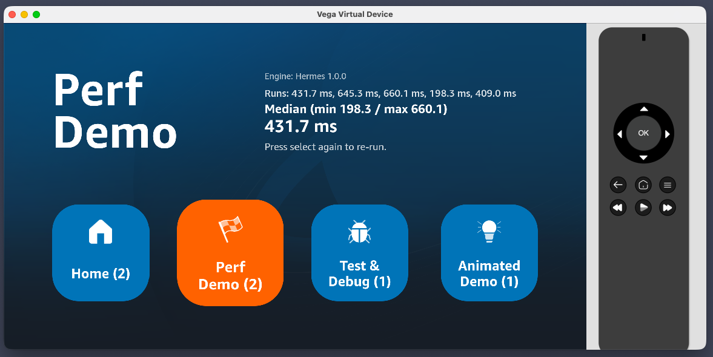
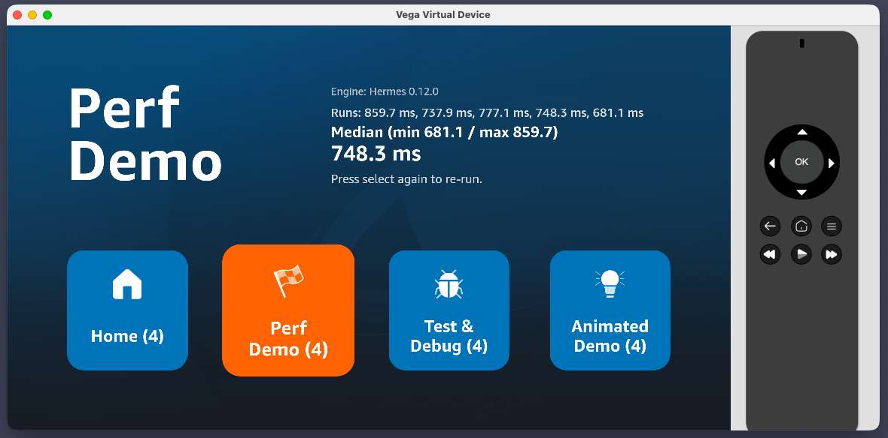

# See Hermes v1 (Static Hermes) in action

In this step you will compare JavaScript runtime performance between React Native 0.72 and 0.83.

## Before you start

Start on `release-rn-83`. We'll build the benchmark there first, capture its numbers, then cherry-pick back to `main` for comparison.

> ⚠️ **Use release builds for everything in this step.** Debug builds make Hermes timings meaningless.

## What Hermes v1 brings

Hermes is the JavaScript engine that ships with React Native. RN 0.72 runs an older Hermes; RN 0.83 ships **Hermes v1**, also called "Static Hermes." It adds ahead-of-time compilation and type specialisation the older bytecode interpreter didn't have, with the biggest improvements landing on numeric tight loops, recursive call dispatch, and string-heavy parsing.

We'll measure matrix multiplication because it's a workload where Hermes v1's type specialisation has the most to do, and the mental model ("multiply two grids of numbers") is universal.

## Step 1: Add the benchmark utilities

Two new files in the shared package — copy them in from the references folder:

- [`hermesInfo.ts`](./references/hermes/hermesInfo.ts) → `packages/shared/src/utils/hermesInfo.ts`
- [`benchmark.ts`](./references/hermes/benchmark.ts) → `packages/shared/src/utils/benchmark.ts`

`benchmark.ts` is where the matrix multiply lives. The loop in there looks like this:

```
For each cell (i, j) in the N×N result:
  sum = 0
  for k = 0 .. N-1:
    sum += A[i][k] * B[k][j]
  result[i][j] = sum
```

Three nested numeric loops — exactly the shape Hermes v1's type specialisation is designed to win on. The benchmark runs this on 240×240 matrices five times and reports the median.

## Step 2: Repurpose the API Demo tile

### 2a. Replace `packages/shared/src/components/ApiDemo.tsx`

Copy [`ApiDemo.tsx`](./references/hermes/ApiDemo.tsx) over the existing file at `packages/shared/src/components/ApiDemo.tsx`.

### 2b. Add `onSelect` to `Tile`

In `packages/shared/src/components/Tile.tsx`, add an `onSelect` prop and wire it to `TouchableOpacity`'s `onPress`:

```tsx
export interface TileProps {
  // ...existing props
  onSelect?: () => void;
}

export const Tile = ({ /* existing props */ onSelect, ...rest }: TileProps) => {
  return (
    <TouchableOpacity
      // ...existing props
      onPress={onSelect}
      // ...
    >
      {/* unchanged */}
    </TouchableOpacity>
  );
};
```

### 2c. Wire it up in `HomeScreen`

In `packages/shared/src/screens/HomeScreen.tsx`, track a `perfRunId` and bump it when the perf tile is selected:

```tsx
const [perfRunId, setPerfRunId] = useState(0);

const handleTileSelect = (tileId: string) => {
  if (tileId === "api-demo") {
    setPerfRunId((id) => id + 1);
  }
};
```

Pass `runId={perfRunId}` to `<ApiDemo>` and `onSelect={() => handleTileSelect(tile.id)}` to each `<Tile>`:

```tsx
{
  focusedTileId === "api-demo" && <ApiDemo runId={perfRunId} />;
}

{
  tiles.map((tile) => (
    <Tile
      // ...existing props
      onSelect={() => handleTileSelect(tile.id)}
    />
  ));
}
```

### 2d. Update the tile metadata

In `packages/shared/src/data/tiles.tsx`:

```tsx
{
  id: 'api-demo',
  label: 'Perf\nDemo',
  accessibilityLabel: 'Performance Demo',
  description:
    'Press select to multiply two 240×240 matrices five times — a workload where Hermes v1 typically wins big.',
  icon: require('../assets/get-started.png'),
},
```

### 2e. Build, launch, and capture the `release-rn-83` numbers

Run the release build. Focus the **Perf Demo** tile and **note the engine line** — record the Hermes version. Press select, wait for all 6 runs (1 warmup + 5 timed), then capture a screenshot of the engine line, runs, and median.

✅ **Checkpoint:** Screenshot from `release-rn-83` showing the new Hermes version, 5 run timings, and a median.



## Step 3: Capture timings on `main` (RN 0.72 / older Hermes)

Commit your changes on `release-rn-83`, capture the commit SHA, then cherry-pick it onto `main`:

```bash
git add .
git commit -m "Repurpose API Demo as Hermes matrix-multiply benchmark"
git rev-parse HEAD   # copy the SHA

git checkout main
git cherry-pick <paste-the-SHA-here>
yarn workspace @multitv/vega run build:release
```

Re-launch the same way as Step 2e. When the Perf Demo tile loads, **the engine line should now show an older Hermes version**. If it still says the same as `release-rn-83`, the build picked up the wrong engine — stop and investigate before measuring.

Run the demo, capture the screenshot.



✅ **Checkpoint:** Second screenshot from `main` showing the older Hermes version and a meaningfully higher median.

## Step 4: Compare the numbers

Place the two screenshots side by side — the `release-rn-83` median should be meaningfully lower than `main`'s. Compare _direction_, not absolute numbers (which depend heavily on your host machine and matrix size), and only compare branches running on the same device.

ℹ️ For the most representative numbers, run this on a **real Fire TV Stick** rather than the Vega Virtual Device. The VD shares your Mac's CPU, so M-series hosts make every workload look fast and unstable. A physical Fire TV Stick has predictable thermals, no host contention, and the timings will be closer to what your users actually experience.

## Step 5 (optional): Push further with Perfetto

This benchmark only measures one thing — synchronous JS work in a hot loop. The biggest Hermes v1 wins also include **cold start** (bundle parse) and **GC behaviour under sustained load**, neither of which a single in-app benchmark captures.

If you want to go deeper, capture a Perfetto trace of the app on each branch and feed it to the Vega Builder Tools MCP's trace analyser:

🤖 **Prompt your agent:**

```
Capture a Perfetto trace of my Vega app's cold start and the first few seconds of interaction, then use the Builder Tools MCP's trace analyser to compare it against an equivalent trace from the main branch.
```

The trace will show JS thread time, GC pauses, and frame timings — the framework-level signals our `performance.now()` benchmark can't see.

---

**Previous:** [Use React Native DevTools](./3-react-native-devtools.md) · **Next:** [Explore the wider 0.83 ecosystem](./5-libraries-and-styling.md)
